<!-- readme-standard: 2026-11-02 -->
<div align="center">



# Wilson's Lawn Maintenance AI Assistant

*An AI-powered voice and chat assistant for lawn care scheduling, quoting, and customer communication — built with Vite, React, TypeScript, and Tailwind CSS.*


[](https://github.com/drasticstatic/.github)
[](https://lovable.dev/projects/70b34eb1-2cf6-45b3-9783-075fb5efa0f6)
[](https://vitejs.dev)
[](https://code.claude.com/docs/en/cli-reference)
[](https://github.com/drasticstatic/wilson-lawn-ai-assist/actions/workflows/sync-public.yml)

 **You are here:** drasticstatic lab › `wilson-lawn-ai-assist` · private source · `main` is the working branch · public twin `wilson-lawn-ai-assist-public`

</div>

##  TL;DR

1.  **What this is.** A lawn-care assistant prototype, and a reusable AI-agent and voice-interface template for small service businesses.
2.  **Who it is for.** Anyone building a voice or chat helper for a small service business.
3.  **Do this first.** Run `npm install` then `npm run dev`; see [Getting Started](#-getting-started).

## 🌐 Live Previews

| Surface | Link |
|---------|------|
| **GoHighLevel site** (original build) | [Preview ↗](https://app.gohighlevel.com/v2/preview/4eNJavgKGMm6OpZoVw7k) |
| **Lovable preview** | [Preview ↗](https://preview--wilson-lawn-ai-assist.lovable.app) |
| **Public repo preview** | [drasticstatic/wilson-lawn-ai-assist-public ↗](https://github.com/drasticstatic/wilson-lawn-ai-assist-public) |

---

## 📖 About

This project started as a GoHighLevel site build, then moved to [Lovable](https://lovable.dev) for a React/Vite iteration. It serves as both a functional lawn-care assistant prototype and a reusable AI-agent + voice-interface template for small service businesses.

---

## 🛠 Tech Stack

- **Vite** — build tool
- **TypeScript + React** — component framework
- **Tailwind CSS** — utility-first styling
- **shadcn/ui** — component library
- **ElevenLabs** (`@11labs/react`) — voice agent (API key entered at runtime)

---

## 🚀 Getting Started

```bash
git clone https://github.com/drasticstatic/wilson-lawn-ai-assist.git
cd wilson-lawn-ai-assist
npm install
npm run dev
```

> **ElevenLabs voice:** Enter your API key in the app UI at runtime — it is never hardcoded or committed.

---

## ✏️ Editing

**Via Lovable:** [Open project ↗](https://lovable.dev/projects/70b34eb1-2cf6-45b3-9783-075pb5efa0f6) — changes auto-commit to this repo.

**Via local IDE:** Clone, edit, push — changes reflect in Lovable.

**Via GitHub:** Edit files directly in the browser.

---

## 🔒 Security

See [SECURITY.md](SECURITY.md) for vulnerability reporting. No real API keys are stored in this repo — voice credentials are entered at runtime only.

---

*Maintained by [drasticstatic](https://github.com/drasticstatic)*

##  Suggest a change

Noticed something? Open an [issue](../../issues) or a pull request against `main`; Christopher reads them and a person with the role merges. Not on GitHub? Reach Christopher through [his contact page](https://drasticstatic.github.io/resume/pages/contact.html).

<sub>The front door follows the living [README standard](https://github.com/drasticstatic/my-template/blob/main/README-STANDARD.md). Copy it, improve it.</sub>
